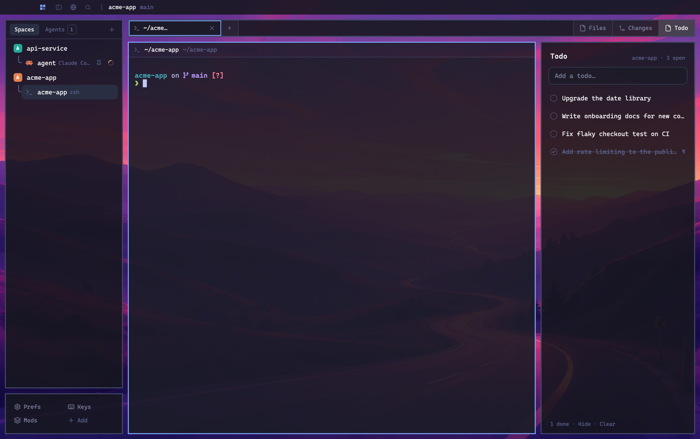

# Todo (kata-todo)

A mod for the Herdr desktop app: a small todo list for the repository of the
terminal you are in, shown in Herdr as **Todo**. Each repository on each
machine has its own list. Add items, tick them off, add a note (a long title wraps while you edit it), and, where
[kata](https://katatracker.com) is installed, send any open item to kata as an
issue with one click; the row then shows the issue's short id and is ticked
off.



## Install

> Read ~/.config/herdr-app/AGENTS.md, then add this mod: https://github.com/karun012/herdr-mod-kata-todo

The agent copies `mods/kata-todo` into `~/.config/herdr-app/mods/` and, since
the mod does not place itself, adds it to your layout (by default as a third
panel next to Files and Changes). `RECIPE.md` has the details.

Requirements:

- `git` on the space's machine, to find the repository.

Optional, for sending items to kata:

- [kata](https://katatracker.com) on the PATH of the space's machine, and a
  `.kata.toml` in the repository or a folder above it (`kata init`). With both,
  open items get a `→ kata` button; without them, it's a plain todo list. kata
  picks the project from the repository's `.kata.toml`, so each repository's
  todos go to that repository's kata project.

## How it works

- **Which list.** The repository (`git rev-parse --show-toplevel`) of the
  focused terminal's live folder, on that space's machine. Outside git, the
  folder itself. While a non-terminal pane (a diff, a viewer) has focus, or the
  terminal's folder is unknown, the current list stays. With nothing focused
  yet (first load), the space's first terminal's folder is used. A new tab that
  cd's to `~` shows the home list.
- **Data.** Stored in Herdr shared state under the key `kata-todo.lists`
  (Herdr's `shared.json`), kept across restarts. Nothing is written in your
  repositories. The Hide/Show choice for done items is one `localStorage`
  flag.
- **Undo.** `×` and Clear act at once; for 30 s the footer offers Undo, which
  puts the items back where they were.
- **Sending.** `→ kata` runs, in the repository folder on the space's
  machine:

  ```
  kata create --idempotency-key todo-<id>-<hash> [--body <note>] --json -- <title>
  ```

  The issue's short id is shown on the row and the item is marked done: once
  it is a kata issue, kata tracks it. You can untick it. If kata finds similar issues the
  row shows `looks like <refs>` and nothing is created; other failures show
  kata's error message and leave the item open. The mod does no tracking after
  that.
- **Idempotency.** The key includes a hash of the title and note. Pressing
  `→ kata` twice returns the same issue; editing the item after a failed send
  gives a new key, since kata refuses a reused key with changed fields.
- The mod makes no network requests of its own and runs only `git`,
  `sh -c 'command -v kata'` and `kata create`.

## Development

```sh
just test      # unit tests for list.js, repo.js, kata.js (node --test)
just check     # herdr-app check on mods/kata-todo
just install   # test, check, then rsync the mod into ~/.config/herdr-app/mods/kata-todo
```

`just install` honours `HERDR_APP_HOME`. Design notes are in
`docs/superpowers/specs/2026-11-16-kata-todo-design.md`.

## License

MIT, see `LICENSE`.
