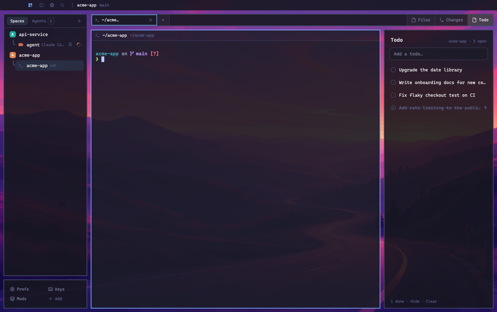

# Todo

A quiet todo list for the repository of the terminal you are in. Each
repository on each machine has its own list. Type to add an item, tick it off,
click it to edit its title and add a note, and, where `kata` is installed,
send any open item to kata as an issue with one click; the row then shows the
issue's short id and is ticked off.



## What you see

One column, drawn only from `theme()` colours, background `chrome`, text
`foreground`. Sizes are px at zoom 1.

- **Header** (padding 18 sides, 16 top, 10 bottom, bottom-aligned): `Todo` at
  15px semibold on the left; `<repo name> · N open` at 11px `dim` on the
  right, where the repo name is the basename of the repository path (`~` for
  home) and N counts the items not done. Empty until the repository is known.
- **Add field** under it: 36px high, 14px side margin, 10px below, 12px inner
  padding, radius 8, 1px `border`, background `background`. A single-line
  input at 13px `foreground`, placeholder `Add a todo…`.
- **List**, scrolling, filling the rest. Open items first in stored order
  (newest first), then done items. Each row: padding 18 sides, 8 top and
  bottom, gap 10, 13px text:
  - a 14px ring, 1px `dim` border; when done, a 9px `dim` check inside (`check.svg`);
  - the title, one line, truncated (in the open row it wraps); `foreground`,
    or `dim` with a strikethrough when done;
  - a `¶` (11px `dim`) when the item has a note;
  - once sent, a chip with the kata short id: 11px `dim`, 5px side padding,
    radius 4, 1px `border`; the item is then done;
  - while sending, `sending…` (11px `dim`).
- **Open row** (after clicking a title): items align to the top, so the ring
  stays at the first line. The title becomes an editable 13px textarea, 1 row,
  growing to 6, so a long title wraps; below it, indented 42px (18 right, 8 bottom), a note textarea at
  12px `muted` with placeholder `Note`, 2 rows, growing to 8.
- **Error line** under a closed row, indented 42px (18 right, 6 bottom): 11px
  `ansi1` at opacity 0.8, one line, truncated.
- **Empty**: `Nothing to do.` centred, 12px `dim`.
- **Footer**, only when there are done items (padding 18 sides, 10 top and
  bottom, gap 6, 11px `dim`): `N done · Hide · Clear`; while hidden,
  `N done hidden · Show · Clear`.

## How it behaves

It shows no agent status; it follows the focused terminal.

- **Which list.** `listFolder(focused(), space, panes())`: the focused
  terminal's live folder (`focused().cwd`). While a non-terminal pane (a diff,
  a viewer) has focus, or the terminal's folder is unknown, the current list
  stays. With nothing focused at all (first load), the shown space's first
  terminal (the first terminal pane of the space's lowest-`index` tab), its
  live folder; else `space.folder`; an empty folder means home. On the space's
  machine it runs `git rev-parse --show-toplevel` there; outside git it uses
  the folder itself. It is re-resolved when that machine and folder change
  (checked every 500 ms), so a new tab that cd's to `~` shows the home list. The list key is `<machine or "local">:<path>` (`~` for an empty
  path). The previous list stays drawn until git answers. Moving to another
  repository closes an open row (saving it first).
- **Add.** Enter in the add field puts the item at the top and clears the
  field. Blank or whitespace-only text adds nothing; runs of whitespace
  collapse to one space.
- **Escape** closes the open row if there is one, otherwise clears the add
  field.
- **Hover** a closed row: background `raised`; at the right, `→ kata` (11px
  `accent`) when kata is on the machine's PATH, a `.kata.toml` is in the
  repository or a folder above it, and the item is not sent and not done, and `×` (11px `dim`). Neither shows while sending.
- **Ring** click toggles done.
- **×** deletes the item at once, no confirmation.
- **Title** click opens the row in place and focuses the title, which wraps
  when long. Clicking another title saves this one and opens that one. Enter
  in the title or Escape closes it: the title is a textarea, so a typed newline
  is caught on `change`, the value is cleaned to one line and the row closes.
  Titles are stored as one line. Edits are written 500 ms after the last keystroke, on
  blur, on closing the row and when the mod closes. Clearing the title keeps
  the old title; the note is trimmed.
- **→ kata** runs `kata create` in the repository folder on the space's
  machine (60 s timeout). While it runs the row shows `sending…`. Success
  stores the short id, shows the chip and marks the item done (once it is a
  kata issue, kata tracks it): it is ticked, sinks below the open items struck
  through, and counts in `N done · Hide · Clear`, where Hide and Clear apply to
  it like any done item. You can untick it.
  Failure shows one line under the row: `looks like <refs>` when kata finds
  look-alike issues (refs comma-separated), else kata's error message, else
  the first line of its output, else `kata exited with <code>`. The item
  stays open and `→ kata` returns; sending again clears the error. A reply that
  comes after you moved to another repository still updates the item it was
  sent for. `sending…` and errors live in memory only.
- **Hide / Show** stops or resumes drawing done items. One flag for the whole
  mod copy, kept across repositories and restarts. **Clear** removes all done
  items from this list.
- With no `kata` on the machine's PATH, or no `.kata.toml` at or above the
  repository, it is a plain todo list: no `→ kata`. The `.kata.toml` check runs
  when the list changes repository and every 30 s after, so `kata init` shows
  `→ kata` without switching folders.

## Built from

`mods/kata-todo/` only; the repository's `tests/`, `docs/`, `justfile` and
`package.json` are development files.

| File | Role |
|---|---|
| `mod.json` | `{ "place": "none", "title": "Todo" }` |
| `main.js` | The `View`: resolves the repository, reads and writes shared state, runs `git`, `sh` and `kata` through `exec`, draws the list. |
| `list.js` | Pure functions on todos and the lists map (`listKey`, `newTodo`, `updateTodo`, `markSent`, `applyToList`, ...). No Herdr imports. |
| `repo.js` | Pure: `listFolder(focus, space, panes)`, `repoFolder(space, panes)`, `parseToplevel`, `repoName`. |
| `kata.js` | Pure: `createArgs(todo)`, `idempotencyKey(todo)`, `parseCreate({code, stdout, stderr})` returning `{ref}` or `{error}`. |

**Herdr calls.** From `"herdr"`: `spaces`, `panes`, `focused`, `exec`, `shared`,
`setShared`, `theme`, `checking`. From `gpui-base`: `v_flex`, `h_flex`,
`InputState`/`Input` (the add field), `TextareaState`/`Textarea` (title and note). No commands, no `hc`, no
`fetch`, no files read.

**Programs it runs**, all with `exec` on the shown space's machine (`on`):

- `git rev-parse --show-toplevel` in the focused terminal's folder, when that
  machine or folder changes (checked every 500 ms).
- `sh -c 'command -v kata'`, once per machine per mod copy.
- `readTextFile` of `<dir>/.kata.toml` for the repository and each folder
  above it (on the space's machine), until one exists.
- `kata create --idempotency-key todo-<id>-<hash> [--body <note>] --json -- <title>`,
  in the repository folder, only when the person presses `→ kata`.
  `<id>` is the item's 6-character random id; `<hash>` is a 32-bit FNV-1a
  hash, base 36, of `title + "\0" + note`. `--body` only when the note is
  not empty. The short id is `.issue.short_id` of the JSON on stdout.

It has no network access of its own (kata does whatever kata does).

**What it stores.** Herdr shared state, one key `kata-todo.lists` (saved in
`shared.json`), a map from list key to an array of
`{ id, title, note, done, created, kata }` (`created` in seconds, `kata` is
`null` or `{ "ref": "<short id>" }`); an emptied list is removed from the map.
Plus one `localStorage` flag, `kata-todo.hide-done` (`"1"`/`"0"`). Nothing is
written in any repository.

**Placing it.** `place` is `"none"`, so adding the folder shows nothing until
a layout puts it somewhere. Recommended: a block in the person's side-panel
stack.

```json
{ "id": "todo", "type": "block", "content": { "mod": "kata-todo" } }
```

In Herdr's shipped `main` layout and its clones that stack is `panel-body`,
inside the hidden column `panel`, next to the `files` and `changes` blocks;
add the block as a third child there. Shipped layouts are read-only: clone
first (`herdr-app do layout.clone '{"name":"main","as":"<name>"}'`) or edit
the person's own layout. If it is not clear where it belongs, ask.

A button for it in the tab bar is the tab bar mod's job; the shipped `tabs`
and `workspace-chrome` may not offer one. Without one the panel opens with
`layout.select {stack: "panel-body", child: "todo"}` then
`layout.show {id: "panel"}`. To bind that, ask the person which key, then add
to `keys.json`, for example under `global`:

```json
"<the person's key>": { "command": "layout.select", "args": { "stack": "panel-body", "child": "todo" } }
```

(and, if the panel may be hidden, a second key or step for
`{ "command": "layout.show", "args": { "id": "panel" } }`).

## Watch out

- Copy only `mods/kata-todo` into `~/.config/herdr-app/mods/`. Never
  overwrite: on a clash, rename the folder and the `mod` name in the layout
  block, and the one asset path in `main.js`, `svg("mods/kata-todo/check.svg")`.
  Its modules are imported relatively (`./list.js`, `./repo.js`, `./kata.js`).
- `herdr-app check` writes `gpui-kit.d.ts`, `jsconfig.json` (and possibly
  `herdr.d.ts`) into the mod folder for editor typing. Don't copy or commit
  them.
- `herdr-app check` only draws the empty state: `init` returns before
  starting the repository timer when `checking()`, so the check shows the
  header, the add field and `Nothing to do.`, and runs no `git` or `kata`.
- Inputs emit no Escape event. Escape is an `on_key_down` on the root
  element matching `"escape"`.
- Put `--` before the title in `kata create`: a title starting with `-` is
  otherwise parsed as a flag.
- With `--json`, kata prints success JSON on stdout but error JSON on
  stderr (`{"error": {"code", "message", "data", ...}}`). The parser takes
  the whole text, else its last line starting with `{`, because a wrapper may
  print first.
- kata's duplicate refusal is `error.code` `duplicate_candidates` (exit 5),
  refs in `error.data.candidates[].short_id`. The mod never passes
  `--force-new`.
- kata returns the original issue for a repeated idempotency key but refuses
  a reused key with changed fields (`idempotency_mismatch`). The key carries
  a hash of title and note so a double click is harmless and an edit after a
  failed send gets a fresh key.
- Every write re-reads `shared("kata-todo.lists")`, applies one change to one
  list, and calls `setShared` only if something changed; edits patch only the
  fields that changed. Two copies of the mod never overwrite each other, and
  nothing is written per keystroke (every `setShared` re-renders every mod).
- `kata` comes from the PATH of the space's machine and picks its project
  from the repository's `.kata.toml`. Any wrapping of kata is the person's
  own setup.

## Done when

- `herdr-app check` on the mod folder passes and shows `Todo` and
  `Nothing to do.`
- In a git repository, the header reads `<repo> · 0 open`; adding an item
  with Enter shows it at the top and the count goes up.
- Clicking a title opens the title and note fields; typing a note and
  pressing Escape closes the row and shows `¶`.
- A long title wraps when the row is opened, and Enter closes the row.
- Ticking the ring moves the item below the open ones, struck through, and
  the footer reads `1 done · Hide · Clear`; Hide hides it, Clear removes it.
- In a repository with a `.kata.toml` where `kata` is on the PATH, hovering
  shows `→ kata`; in one without, it doesn't; pressing it shows
  `sending…`, then the short id chip, and the issue exists in that
  repository's kata project. The sent item is ticked and sits below the open
  ones. Sending the same title again from a new item
  shows `looks like <ref>`.
- In a space whose machine has no `kata`, no `→ kata` appears.
- Switching to a space in another repository shows that repository's list.
- A new tab that cd's to `~` shows a separate (home) list.
